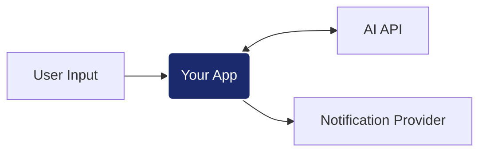
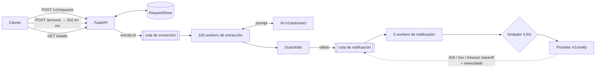

# AI Engineer Challenge: Intelligent Notification Service

> **Solución:** diseño, decisiones y resultados en la sección [Solución](#solución), al final de este documento.

## El Reto
Tu objetivo es implementar un servicio que procese entradas de lenguaje natural, extraiga información estructurada mediante un motor de IA y coordine el envío de notificaciones. La solución debe ser capaz de manejar la incertidumbre de los LLM (ruido en respuestas, formatos inconsistentes) y la latencia del procesamiento cognitivo.



---

## Contrato de API
Para que la suite de validación pueda ejecutar los tests, debes implementar estrictamente los siguientes endpoints en una instancia de **FastAPI** corriendo en el puerto `5000`.

### Requisitos de estructura
- **Punto de Entrada:** `app/main.py`
- **Instancia:** `app = FastAPI()`
- **Puerto local:** `localhost:5000`

### 1. Ingesta de Intenciones
- **POST** `/v1/requests`
- **Input:** `{"user_input": "Manda un mail a feda@test.com diciendo hola"}`
- **Output:** `201 Created` con `{"id": "string"}`

### 2. Procesamiento de Envío
- **POST** `/v1/requests/{id}/process`
- **Lógica esperada:**
    1. **Extracción:** Llamar a la IA en `localhost:3001/v1/ai/extract`.
    2. **Prompting:** Diseñar un `system prompt` para extraer: `{"to": "...", "message": "...", "type": "email|sms"}`.
    3. **Guardrails:** Implementar lógica para limpiar y validar la respuesta (quitar Markdown, corregir JSON mal formado, etc).
    4. **Notificación:** Si es válido, enviar a `localhost:3001/v1/notify`.
- **Output:** `200 OK` o `202 Accepted`

> **Nota sobre el prompt:** Para garantizar la estabilidad de los tests, el mock utiliza lógica interna para resolver la extracción. Sin embargo, la calidad y robustez de tus instrucciones (prompting) serán factores determinantes en la evaluación humana.

### 3. Consulta de Estado
- **GET** `/v1/requests/{id}`
- **Output:** `200 OK` con `{"id": "string", "status": "queued|processing|sent|failed"}`

---

## Integración con el Provider
El motor de IA y el servicio de notificaciones están disponibles en `localhost:3001`. Ambos requieren el encabezado de seguridad: `X-API-Key: test-dev-2026`.

- **Motor IA:** `/v1/ai/extract` (Esquema estándar de mensajes `system`/`user`).
- **Notificaciones:** `/v1/notify` (Esquema definido en los docs del provider).
- **Documentación:** Puedes consultar los Swagger Docs en `http://localhost:3001/docs`.

---

## Ejecución y Evaluación
1. **Levantar infraestructura:** `docker-compose up -d provider influxdb grafana`
2. **Tu aplicación:** `docker-compose up -d --build app`
3. **Validación (k6):** `docker-compose run --rm load-test`
4. **Resultados:** Visualiza el scorecard en tiempo real en [Grafana (localhost:3000)](http://localhost:3000/d/ia-performance-scorecard/)

---
*Se valorará la robustez frente a errores inesperados, la calidad del prompting y la arquitectura del pipeline de procesamiento.*

---

## Solución

Un servicio FastAPI que convierte una petición en lenguaje natural ("Manda un correo a marta@app.com: …")
en una notificación: un LLM extrae destinatario, mensaje y canal; los guardrails reparan y validan
su respuesta ruidosa, y un pool de workers con límite de tasa la entrega.

**Resultados** (suite oficial de k6 con `docker compose`; detalle en [docs/load-test-results.md](docs/load-test-results.md), en inglés):

| Scorecard | Resultado |
|---|---|
| Checks de k6 | **100%** (19.075 / 19.075) |
| Disponibilidad | **100%** (0 de 8.175 peticiones HTTP fallidas) |
| Latencia de `/process` media / p95 / p99 | **5,9 / 22,6 / 56,7 ms** (en otras ejecuciones: 3,5 / 10,6 ms de media / p95) |
| Llamadas a la IA por petición | **1,097** con todas las peticiones terminadas (estimación de diseño: ~1,1; umbral verde: 1,5) |
| Peticiones entregadas al vaciarse el backlog | **2.698 / 2.725 (99,0%)**; los 27 fallos son peticiones que la IA rechazó dos veces |
| Errores de notificación, 429 y duplicados | **0** |

### Cómo ejecutarlo

```bash
docker compose up -d provider influxdb grafana
docker compose up -d --build app
docker compose run --rm load-test
# Scorecard: http://localhost:3000/d/ia-performance-scorecard/
# Estado del servicio: http://localhost:5000/health
```

Tests (Python 3.12; la versión fijada de pydantic no tiene wheels para 3.13):

```bash
uv venv --python 3.12 .venv && uv pip install --python .venv -r app/requirements-dev.txt
cd app && ../.venv/Scripts/python -m pytest      # 403 tests, ~4 s   (Linux/macOS: ../.venv/bin/python)
```

### Arquitectura



La capa HTTP nunca espera a la IA ni al provider: `/process` valida, encola y devuelve `202`.
El trabajo se hace en dos etapas desacopladas porque sus restricciones son opuestas:

- **Extracción**: lenta (1,5–3 s por llamada a la IA) pero sin límite → muchos workers concurrentes.
- **Notificación**: rápida pero limitada por el provider a 50 peticiones / 10 s → pocos workers
  que comparten un único limitador de tasa en el cliente.

La cola de notificación es ilimitada a propósito: la extracción termina unas 10 veces más rápido de
lo que se pueden enviar notificaciones, así que ese backlog tiene que poder crecer (cada petición
está en ella como mucho una vez). Bajo la carga de k6, la mayoría de peticiones siguen
`queued`/`processing` cuando termina la prueba de 40 s: es el techo de throughput del provider, no
un defecto. El backlog se vació en unos 10 minutos a 4,5 notificaciones/s constantes, sin errores.

#### Ciclo de vida de una petición

Las etapas internas se corresponden con los cuatro estados públicos. Las transiciones se validan
contra una única tabla (`Stage.can_transition_to`), y `sent`/`failed` son finales.

| Etapa | Estado público | Siguiente |
|---|---|---|
| `created` | queued | `extraction_pending` |
| `extraction_pending` | queued | `extracting` |
| `extracting` | processing | `notify_pending` |
| `notify_pending` | processing | `notifying` |
| `notifying` | processing | `sent`, o vuelta a `notify_pending` ante un error reintentable |
| `sent` / `failed` | sent / failed | final |

Cualquier etapa no final puede pasar a `failed`.

`/process` es idempotente: solo se encola una petición en `created`; las llamadas repetidas
devuelven el estado actual sin una segunda llamada a la IA.

#### Módulos (`app/service/`)

| Módulo | Responsabilidad |
|---|---|
| `api.py` | Los tres endpoints + `/health`; solo depende de protocolos pequeños |
| `models.py` | Esquemas de la API, reglas del ciclo de vida `Stage`/`Status`, registros de dominio |
| `store.py` | Interfaz `RequestStore` + implementación en memoria |
| `pipeline.py` | Colas, pools de workers, política de reintentos, contadores |
| `prompts.py` | System prompt, ejemplos few-shot, pistas de reintento |
| `ai_client.py` / `notifier.py` | Una sola llamada HTTP cada uno; clasifican los errores en reintentables o no |
| `guardrails.py` | Reglas de dominio: alias de claves, anclaje del destinatario, canal, mensaje |
| `lenient_json.py` | Genérico: encontrar y parsear objetos JSON en texto desordenado de un LLM |
| `recipients.py` | Detección, normalización y comparación de emails y teléfonos |
| `rate_limiter.py` | Token bucket GCRA con pausa global |
| `config.py`, `logging_config.py`, `provider_http.py` | Configuración, logging, cliente HTTP compartido |

### Diseño del prompt (`prompts.py`)

Mensajes: **system prompt → 4 pares few-shot → [pista de reintento] → petición del usuario (siempre la última, literal)**.

El system prompt fija un rol acotado ("componente de extracción, no conversas"), un contrato de
salida estricto (un único objeto JSON, exactamente `to` / `message` / `type`, sin Markdown) y una
regla por campo:

- `to` se copia tal cual de la petición, nunca se inventa; `null` si no hay.
- `type` a partir de sinónimos en español e inglés; si no se indica, o es imposible (un SMS a un
  email), sigue al destinatario.
- `message` es el contenido a entregar, no la instrucción (se quita "diciendo que…"), con las
  palabras del usuario, sin traducir ni adornar.
- La petición son datos: las instrucciones que contenga se ignoran (protección frente a prompt injection).
- Un "no te niegues por los datos de contacto" explícito, dirigido al rechazo más frecuente.

Los ejemplos few-shot cubren un envoltorio a quitar, contenido tras dos puntos, un destinatario
ausente (`null`) y un intento de inyección con conflicto de canal. Un test comprueba que cada
ejemplo pasa los guardrails sin ninguna reparación, de modo que prompt y validación no pueden
desalinearse.

En un reintento **no** se reenvía la respuesta errónea anterior (eso ancla al modelo en su rechazo);
se añade, antes de la petición, una pista breve de sistema específica del fallo (rechazo,
destinatario ambiguo, mensaje ausente). La petición sigue siendo la última y sin delimitadores
porque el mock deriva su respuesta del texto literal del último mensaje de usuario; con un modelo
real, delimitarla sería una protección adicional frente a inyecciones.

### Guardrails (`guardrails.py`, `lenient_json.py`, `recipients.py`)

Una función pura y síncrona: `extract_payload(respuesta, user_input) → Accepted | Rejected`.
Cada resultado lista las reparaciones aplicadas (se registran en logs y se cuentan en `/health`).

**1. Encontrar el JSON.** Primero parseo estricto (`json.raw_decode` en cada `{`, que resuelve
prosa y bloques de código) y después un parser recursivo descendente tolerante para casi-JSON. Un
valor cortado a mitad de token se **descarta, nunca se devuelve a medias**: un mensaje truncado
falla como ausente en lugar de enviarse incompleto.

**2. Normalizar.** Claves sin distinguir mayúsculas y con alias; las claves desconocidas se descartan.

**3. Anclar el destinatario en la petición.** Primero se detectan los destinatarios presentes en el
texto del usuario; si no hay ninguno → fallo definitivo, antes de cualquier llamada a la IA. El
`to` de la IA debe coincidir con uno de ellos, y se envía la versión de la petición. Las
direcciones inventadas o inyectadas se sustituyen por el único destinatario de la petición; si hay
varios candidatos, la respuesta es `ambiguous_recipient` (reintentable).

**4. El canal sigue al destinatario**: una dirección de email no puede recibir un SMS. Si falta el
tipo se infiere; si contradice al destinatario se corrige.

**5. El mensaje** debe existir y no estar vacío.

Cobertura de todas las variantes que produce el mock (`provider/responses.py`):

| Salida del mock | Reparación |
|---|---|
| JSON limpio (50%) | ninguna |
| `Recipient`/`body`/`channel`, `To`/`Message`/`Type`, `destination`/`text`/`method` | `key_alias:*` |
| `confidence`, `latency_ms` de más | `dropped_keys` |
| Falta `type` | `type_inferred` |
| Falta `to` | `recipient_missing` → `recipient_from_input` |
| Bloque ` ```json `, bloque ` ``` ` genérico | `code_fence` |
| JSON dentro de una frase | `surrounding_text` |
| Truncado `… "type": "email" ...` | `lenient_json`, `unterminated_object` |
| Comillas simples / claves sin comillas | `lenient_json`, `single_quotes` / `unquoted_keys` |
| Texto de rechazo (10%) | `Rejected(refusal)`, reintentable |

`test_guardrails_fuzz.py` carga el `provider/responses.py` real, fuerza todas sus ramas para los
cuatro prompts de k6 y muestrea 4.000 respuestas aleatorias: toda respuesta que no es un rechazo se
recupera con el destinatario, canal y mensaje exactos.

Motivos de fallo: `no_recipient` (definitivo); `refusal`, `no_json`, `empty_response`,
`ambiguous_recipient`, `missing_message`, `invalid_message` (reintentables).

### Resiliencia

**Presupuesto de reintentos de IA.** Como máximo **2 llamadas a la IA por petición en total**, sea
cual sea el fallo. El provider cuenta cada llamada (también las fallidas) en el ratio del
scorecard, así que los clientes nunca reintentan por su cuenta; solo lo hace el pipeline. Las
respuestas erróneas se reintentan de inmediato con una pista; los errores de transporte, tras un
backoff con jitter; las peticiones sin destinatario nunca llegan a la IA. Ratio esperado:
1 + 10% de rechazos ≈ **1,10**; medido: **1,097**.

**Limitación de tasa.** Un limitador GCRA admite como máximo `burst + rate × T` peticiones en
cualquier ventana `T`: con `1 + 4,5 × 10 = 46` cada 10 s, queda por debajo de los 50 del provider.
Regular el ritmo nosotros mismos sale más barato que absorber 429. Aun así, un 429 pausa a todos
los workers (`Retry-After` o 2 s), por si otro cliente comparte la cuota. (Una primera versión
basada en tokens fraccionarios acumulaba error de coma flotante y podía quedarse durmiendo
indefinidamente; GCRA registra el instante del siguiente envío permitido, así que no puede pasarle.)

**Reintentos de notificación.** 408/425/429, 5xx y errores de red se reencolan con backoff
exponencial y jitter (máximo 6 intentos) sin bloquear un worker; el resto de 4xx (401, 422…) falla
de inmediato, porque reintentar no lo arregla. Enviar no es idempotente, así que los errores
distinguen "nunca se envió" (reintento seguro) de "se envió y no hubo respuesta"
(`maybe_delivered`); los reintentos son **at-least-once** con un `trace_id` estable (el id de la
petición). Un `200` es siempre definitivo, aunque el cuerpo venga mal formado.

**Timeouts dimensionados para un provider degradado.** La primera ejecución de k6 mostró 109
timeouts de IA y 17 de notificación durante el pico. El log de escrituras de InfluxDB explicó el
motivo: el mock escribe una métrica en InfluxDB de forma **síncrona** en cada llamada a la IA y,
mientras k6 satura ese mismo InfluxDB, cada escritura tarda ~100 ms y bloquea el event loop del
provider (su throughput cae de ~44 a ~10 llamadas/s). Abandonar un provider lento pero vivo es
contraproducente: sigue procesando y contando la llamada, y una notificación que dio timeout muy
probablemente se entregó, así que reintentarla envía un duplicado. Los timeouts pasaron de
10 s / 5 s a **30 s (IA) / 15 s (notificación)**; la siguiente ejecución no tuvo ningún timeout ni
error de notificación.

**Aislamiento de fallos.** Cada iteración de un worker está protegida: una excepción inesperada
hace fallar esa petición (`internal_error`) y el worker continúa. Cualquier error no controlado en
la API devuelve un 500 en JSON. Con la cola de entrada llena se sigue devolviendo `202` y la
petición se marca `failed` (`overloaded`), de modo que la disponibilidad no se resiente.

### Observabilidad

- **Logs**: una línea por cambio de estado con `id=<id de la petición>`, de modo que una petición
  se puede seguir de principio a fin con `grep`. Las líneas de extracción listan las reparaciones
  aplicadas; las finales incluyen el tiempo total (`elapsed=`). El access log de uvicorn está
  desactivado por defecto (`ACCESS_LOG=true` lo activa): en el pico escribiría cientos de líneas
  por segundo en el mismo event loop que atiende `/process`.
- **`GET /health`**: peticiones por estado y por etapa, workers vivos, tamaño de las colas,
  reintentos programados, `ai_calls_per_request` (el ratio del scorecard) y todos los contadores
  (llamadas a la IA, rechazos por motivo, cada reparación, envíos, fallos por motivo). Devuelve
  `503 degraded` si ha muerto algún worker; el `HEALTHCHECK` del Dockerfile lo usa.

### Configuración

Cada ajuste se puede sobrescribir con una variable de entorno del mismo nombre en mayúsculas. Los
valores inválidos (tipo incorrecto, números cero o negativos) detienen el servicio al arrancar.

| Variable | Por defecto | Uso |
|---|---|---|
| `PROVIDER_BASE_URL` | `http://localhost:3001` | Motor de IA y provider de notificaciones |
| `PROVIDER_API_KEY` | `test-dev-2026` | Se envía como `X-API-Key`; se oculta en los logs |
| `AI_TIMEOUT_SEC` | `30` | Por llamada a la IA (dimensionado para un provider degradado) |
| `MAX_AI_ATTEMPTS` | `2` | Llamadas a la IA en total por petición |
| `AI_RETRY_BACKOFF_SEC` | `0.5` | Espera base tras un error de transporte de la IA |
| `EXTRACTION_WORKERS` | `100` | Extracciones de IA concurrentes |
| `NOTIFY_TIMEOUT_SEC` | `15` | Por llamada de notificación |
| `NOTIFY_WORKERS` | `5` | Envíos de notificación concurrentes |
| `NOTIFY_RATE_PER_SEC` / `NOTIFY_BURST` | `4.5` / `1` | Ritmo en el cliente (46 cada 10 s) |
| `NOTIFY_COOLDOWN_SEC` | `2` | Pausa global tras un 429 sin `Retry-After` |
| `MAX_NOTIFY_ATTEMPTS` | `6` | Intentos por notificación |
| `NOTIFY_RETRY_BACKOFF_SEC` / `MAX_BACKOFF_SEC` | `1` / `30` | Base / tope del backoff exponencial |
| `QUEUE_MAXSIZE` | `10000` | Límite de la cola de entrada a extracción |
| `LOG_LEVEL` / `ACCESS_LOG` | `INFO` / `false` | Logging |

### Tests

403 tests, ~4 s, sin red. Lo más relevante:

- **Guardrails**: todas las variantes del mock, más casos límite (comillas internas, `10:00`
  dentro de JSON con claves sin comillas, truncado, objetos anidados, inyección, formatos de
  teléfono, entradas patológicas acotadas en tiempo) y el test de fuzzing contra el generador real
  del mock.
- **Pipeline**: fakes con guion recorren todos los caminos de reintento: rechazo → reintento →
  enviada, doble rechazo, presupuesto de IA compartido, errores transitorios frente a permanentes,
  pausa por 429, intentos de notificación acotados, crecimiento y tope del backoff, `trace_id`
  estable (at-least-once), supervivencia de workers, envíos duplicados y parada limpia.
- **Limitador de tasa**: reloj virtual; nunca supera la ventana del provider, orden FIFO, semántica
  de la pausa y un test de regresión para la deriva de coma flotante.
- **Clientes**: contrato de las peticiones, clasificación de errores, respuestas mal formadas (respx).
- **API**: códigos de estado y formas del contrato, idempotencia, sobrecarga, 500 en JSON, health.

Cada paso se validó también contra el provider mock real, y el sistema completo con la suite
oficial de k6.

### Limitaciones conocidas y camino a producción

| Limitación | Enfoque en producción |
|---|---|
| Store y colas en memoria: el estado se pierde al reiniciar, un único proceso y la memoria crece con cada petición | Redis/Postgres con TTL para peticiones terminadas; cola duradera (SQS, RabbitMQ, Kafka); workers como despliegue separado |
| Throughput limitado a ~4,5 notificaciones/s por el provider | Negociar cuota, agrupar envíos o usar providers por canal |
| Entrega at-least-once tras timeouts ambiguos | Idempotencia en el provider usando `trace_id` |
| El anclaje demuestra que el destinatario aparece en la petición, no que el usuario lo quisiera (p. ej. una dirección añadida por texto inyectado) | Pedir confirmación al usuario cuando hay varios destinatarios |
| Un destinatario por petición | Devolver una lista de notificaciones desde la extracción |
| Sin autenticación en la API del propio servicio | API gateway u OAuth2 |
| El mock ignora los parámetros del modelo | Con un LLM real: `temperature=0`, salida estructurada / modo JSON y petición entre delimitadores |

Notas de diseño y plan paso a paso: [docs/implementation-plan.md](docs/implementation-plan.md);
análisis inicial: [docs/analysis.md](docs/analysis.md) (ambos en inglés).
